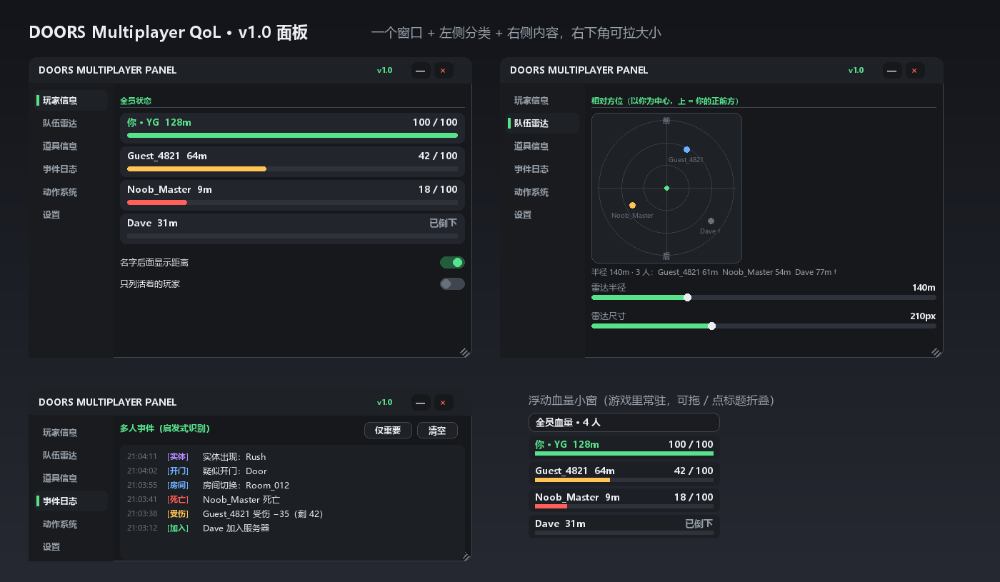

# DOORS Multiplayer QoL · v1.0

一个 Roblox DOORS 用的多人辅助面板：**只开一个窗口**，左侧分类、右侧内容，右下角可以拉大小。
v1.0 把原来散开的「全员血量 HUD」收进主面板，并补齐团队雷达、道具信息、事件日志、动作系统、统一设置。

> 只读游戏数据，不写任何游戏状态；不碰反作弊，不做越权远程调用。

```lua
loadstring(game:HttpGet("https://raw.githubusercontent.com/3091318935/HardCore-v0.1-HP/main/DoorsQoL-v1.0.lua"))()
```



---

## 1. 界面结构

| 区块 | 内容 |
| --- | --- |
| 顶栏 | 标题、版本号、`—` 最小化、`×` 关闭（关闭后按快捷键重新打开）；按住顶栏可拖动窗口 |
| 左侧导航 | 玩家信息 / 队伍雷达 / 道具信息 / 事件日志 / 动作系统 / 设置，选中项左侧一条绿色指示条 |
| 右侧内容 | 当前分类的页面，纵向可滚动；页面懒创建一次后缓存，切换只改 `Visible` |
| 右下角 | 斜纹拖拽点，拉动改窗口大小（最小 420×300）；右侧边、底边也能单独拉 |

窗口尺寸、位置、缩放、透明度、当前分类、快捷键、模块开关全部存在同一份配置里（见 §6）。

## 2. 六个分类

| 分类 | 做什么 | 数据来源 |
| --- | --- | --- |
| 玩家信息 | 全员血量条、距离（米）、死亡状态；「你」排最前并高亮 | 每个角色的 `Humanoid.Health` / `MaxHealth`，`HumanoidRootPart` 间距 |
| 队伍雷达 | 以自己为中心的俯视雷达：上＝你的正前方，圆环＝距离刻度，点＝队友，死后变灰并标 `†` | 同样的位置数据，**复用**玩家信息的距离系统，不重复采样 |
| 道具信息 | 每个队友的背包 / 手持 Tool，按名字列表实时更新（拿、用、丢都会变） | `Backpack` 与 `Character` 下的 `Tool` 实例 |
| 事件日志 | 加入、离开、受伤、死亡、复活、疑似开门、实体出现、房间切换；带时间戳、按类型上色、可只看重要、可清空 | 实例变化 + Humanoid 变化的**启发式**识别 |
| 动作系统 | 快捷键跳舞，六种动作可选、可停止、可换 | 客户端 `Animator:LoadAnimation` |
| 设置 | 面板缩放 80%~150%、透明度、默认分类、模块开关、四个快捷键（含冲突检测）、重置 | 同一份配置 |

## 3. 默认快捷键

| 功能 | 默认键 | 说明 |
| --- | --- | --- |
| 显示 / 隐藏面板 | `RightShift` | 关闭窗口后靠它叫回来 |
| 显示 / 隐藏雷达页 | `N` | 自动展开面板并切到雷达 |
| 跳到事件日志 | `L` | 自动展开面板并切到日志 |
| 跳舞 | `K` | 再按一次停止 |

全部可在 **设置 → 快捷键** 里改：点一下键帽，然后按新键。抢别人的键会被检测出来并在日志里写一条冲突提示。

## 4. 窗口操作

- 拖动：按住顶栏空白处
- 改大小：右下角斜纹，或右侧边、底边
- 最小化：`—`（只剩顶栏），再点一次复原
- 关闭：`×`，之后按面板快捷键重新打开
- 面板缩放：设置里的滑块，整个面板（含文字）等比缩放

## 5. 浮动血量小窗

游戏里常驻在右上角的小条（就是 v0.1 那个全员血量），v1.0 保留：

- 拖标题栏挪位置，位置会记住
- 点标题栏折叠 / 展开
- 字号在 **设置 → 浮动血量字号** 调（10~22px），行高、血条、圆角都跟着字号走
- 设置里的开关可以整个关掉

## 6. 配置与持久化

配置存在执行器工作目录的 `QoL_v1.json`：

```json
{
  "ui": { "x": 60, "y": 60, "w": 620, "h": 440, "scale": 1, "opacity": 0,
          "tab": "player", "hudOn": true, "hudFont": 13, "hudX": 16, "hudY": 96 },
  "keys": { "panel": "RightShift", "radar": "N", "log": "L", "dance": "K" },
  "mods": { "player": true, "radar": true, "inv": true, "log": true, "dance": true },
  "radar": { "range": 140, "size": 210 },
  "dance": { "anim": 1 }
}
```

改完立即生效并写盘（1 秒防抖）。执行器没有 `writefile` 时不会报错，只是不持久化。

脚本也导出 API：

```lua
getgenv().QoL.open(true)        -- 显示面板
getgenv().QoL.tab("radar")      -- 切分类
getgenv().QoL.log("misc", "hi") -- 往日志里写一条
getgenv().QoL.dance(2)          -- 播第 2 个动作
getgenv().QoL.stopDance()
getgenv().QoL.hud(false)        -- 关浮动小窗
getgenv().QoL.save()            -- 立刻写盘
```

## 7. 架构

```
唯一入口 / 主控
├── 主题与控件工厂        label / section / slider / toggle / keybind / button / chip
├── 窗口管理              buildPanel: 顶栏 / 导航 / 页面容器 / 拖动 / 三向拉伸 / UIScale
├── 配置系统              DEFAULT → CONFIG 深合并，loadCfg / saveCfg
├── 页面（懒创建，各带 refresh）
│     player · radar · inv · log · dance · setting
├── 事件日志总线          logAdd(kind, text)，其他模块只管往里丢
├── 浮动血量小窗          Hud.ensure / update / setVisible
└── 采样循环             0.5s 玩家与血量 · 1s 道具 · 0.12s 雷达（只在页面可见时跑）
```

- 一个 `ScreenGui`（`SG_QoL_v1`，`DisplayOrder 999996`），浮动小窗是另一个（`SG_QoL_HUD`，`999997`）
- 页面在第一次切过去时创建，之后只切 `Visible`，不重建、不重复连事件
- 全局输入只挂一套（滑块拖动、窗口拖动在各自控件上），重建面板不会叠加连接

## 8. 诚实边界

| 项 | 说明 |
| --- | --- |
| 雷达方位 | 用自己 `HumanoidRootPart` 的 `LookVector` 做本地坐标旋转；角色朝向不等于镜头朝向，快速转身时会有一点滞后 |
| 雷达范围 | 超出半径的点会被贴到边缘并降低不透明度，不是精确位置 |
| 事件日志 | 启发式：实体靠名字表匹配（Rush / Ambush / Screech / Figure / Seek …），开门靠名字含 `door` / `gate`，房间靠名字含 `room`。识别不了的不会编造，房间目录找不到时会在日志里直接说明 |
| 道具图标 | DOORS 不对外给道具图标 ID，这里只显示名字色块，不伪造贴图 |
| 跳舞同步 | 客户端 `Animator` 播放，**只有自己看得到**；让别人看到需要服务器侧播放。本系统不做未授权远程调用、不碰反作弊 |
| 不做的功能 | 贡献度统计、表现评分、队友排名、参与度分析（合作游戏没意义，需求里也明确不要） |

## 9. 文件

| 文件 | 说明 |
| --- | --- |
| `DoorsQoL-v1.0.lua` | 主脚本，单文件，1915 行 |
| `loader.lua` | 一行 loader（带 `?v=` 绕过 raw CDN 缓存） |
| `push.ps1` | 推送到本仓库（Contents API，未变跳过） |
| `panel-preview.py` / `panel-preview.png` | 按脚本里的真实尺寸重画的面板示意图，可重跑 |

## 10. 变更记录

### v1.0
- 新：统一主面板，左侧六分类 + 右侧内容，单窗口
- 新：窗口拖动 / 三向拉伸 / 最小化 / 缩放 / 透明度
- 新：队伍雷达（相对方位、距离刻度、死亡状态、半径与尺寸可调）
- 新：道具信息（背包与手持，实时同步）
- 新：事件日志（8 类事件、时间戳、只看重要、清空、上限 140 条自动清理）
- 新：动作系统（6 个动作、快捷键、可停、可换）
- 新：设置页统一配置 + 快捷键冲突检测 + 一键重置
- 保留：全员血量 / 距离 / 死亡状态；浮动小窗与 v0.1 的读数、配色一致
- 改：版本号 0.1 → 1.0

### v0.1.2（旧，仍可用）
单功能版，只有右上角全员血量，带「大小」调节条：

```lua
loadstring(game:HttpGet("https://raw.githubusercontent.com/3091318935/HardCore-v0.1-HP/main/HardCore-v0.1-HP.lua"))()
```

回滚：把上面这行换回来即可，v0.1.2 的文件一直留在仓库里，没有被覆盖。
