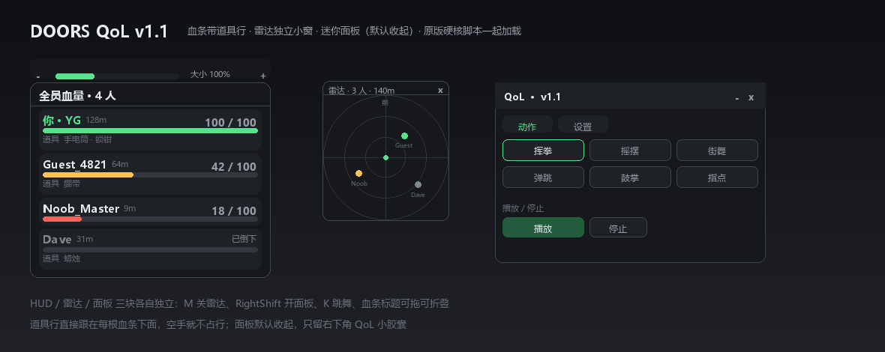

# DOORS Multiplayer QoL · v1.1

一个 loader，三块各自独立的界面：**血条（带道具行）** · **雷达小窗** · **迷你面板**。
同时还负责把原版 **Doors HardCore** 拉起来。

```lua
loadstring(game:HttpGet("https://raw.githubusercontent.com/3091318935/HardCore-v0.1-HP/main/DoorsQoL-v1.1.lua?v=1.1.0"))()
```



---

## 与 v1.0 的区别（为什么改成这样）

| v1.0 | v1.1 |
| --- | --- |
| 620×440 大面板，六页 | 360×300 迷你面板，只有「动作 / 设置」两页，**默认收起** |
| 雷达塞在面板里，要开面板才能看 | 雷达是**独立小窗**，`M` 独立开关，不看面板也常驻 |
| 玩家信息单独一页 | 回到 v0.1 的血条浮层，`SG_HP_v11` |
| 道具信息单独一页 | 并进血条：**每根血条下面一行小字**写队友身上/背包里的道具 |
| 多人事件日志一页 | 整块删掉 |
| 面板常驻挡视野 | 面板默认关闭，只留右下角 `QoL` 小胶囊 |

一句话：**v0.1 的血条是主角，雷达独立，面板退到「要调东西才打开」的位置。**

---

## 三块界面

### 1. 血条浮层 `SG_HP_v11`（DisplayOrder 999997）

- 标题栏 `全员血量 · N 人`，拖动可挪位置，单击可折叠
- 每行：`名字 · 距离` + 右侧 `血量 / 100` + 血条（≥60% 绿 / ≥30% 琥珀 / 其余红 / 死亡灰 + 「已倒下」）
- 名字下方一行小字 `道具  手电筒 · 锁钳`：读的是 `Backpack` 和角色手上 `Tool`，手持的会标「（手持）」，空手就不占这一行
- 标题上方尺寸条：`−` / 滑条 / `大小 100%` / `＋`，10px–26px，拖完松手才生效（不会拖到一半控件消失）
- 设置页还能单独关掉「道具行」

### 2. 雷达小窗 `SG_QoL_Radar`（DisplayOrder 999996）

- 独立 ScreenGui，位置/大小/开关都独立于面板
- 以自己为中心，**屏幕上方 = 你的正前方**；三圈刻度，半径 40–400m 可调
- 队友点带名字，死亡变灰，超出半径的点贴边并变淡
- 标题显示 `雷达 · N 人 · XXm`，右上 `×` 直接关掉；`M` 键开关
- 坐标换算用 `CFrame:PointToObjectSpace`，不手写 sin/cos，避免前后颠倒

### 3. 迷你面板 `SG_QoL_Panel`（DisplayOrder 999998，默认关闭）

- 右下角 `QoL` 小胶囊打开/关闭，`RightShift` 也行
- 只有两页：
  - **动作**：6 个动作（挥拳 / 摇摆 / 街舞 / 弹跳 / 鼓掌 / 指点），点一下就播，再点停止；`K` 直接播放当前动作
  - **设置**：血条开关 / 道具行开关 / 字号 / 血条缩放 / 雷达开关 / 雷达尺寸 / 雷达半径 / 三个快捷键 / 原版脚本加载状态 + 「重新加载」/ 重置
- 右下角斜纹可拖大小（最小 300×220），标题栏可拖动

---

## 默认按键

| 键 | 作用 |
| --- | --- |
| `RightShift` | 开/关迷你面板 |
| `M` | 开/关雷达小窗 |
| `K` | 播放 / 停止当前动作 |

三个都能在设置页点一下重新绑，按 `Escape` 取消。

---

## 原版硬核脚本（重点）

启动后会自动按顺序尝试拉原版 Doors HardCore：

1. `https://pastefy.app/Bf6hbDY4/raw`
2. `https://raw.githubusercontent.com/Zero0Star/RipperNewSound/master/HardCoreLua.lua`
3. `https://raw.githubusercontent.com/Zero0Star/RipperNewSound/master/HardCore-Mode.lua`

> v0.1 里写的 fallback 是 `Doors-HardCore.lua`，**那个文件在仓库里根本不存在**，所以下载失败后直接静默结束——这就是「注入后没弹硬核弹窗」的原因。v1.1 换成了仓库里真实存在的 `HardCoreLua.lua`（393 KB 那版，启动提示 `Doors HardCore V10.6.3`）。

面板「设置」页最下面有一行状态：

- `已加载: pastefy.app` → 用的是 pastefy 那份
- `已加载: raw.githubusercontent.com` → 用的是 GitHub 上的
- `全部源失败（下载失败/编译失败/运行报错）` → 三个都没成，点「重新加载」再试，F9 控制台有每条源的具体错误

加载成功时控制台会打 `[QoL] original script loaded: <url>`。

---

## 配置文件

`QoL_v11.json`（执行器工作目录，首次运行自动生成）：

```json
{
  "hudOn": true, "showItems": true,
  "hudX": 16, "hudY": 96, "fs": 15, "collapsed": false,
  "radarOn": true, "radarSize": 168, "radarRange": 140,
  "radarX": 16, "radarY": 300,
  "panelX": 60, "panelY": 120,
  "anim": 1,
  "kPanel": "RightShift", "kRadar": "M", "kDance": "K"
}
```

删掉这个文件就恢复默认。

---

## API

```lua
local q = getgenv().QoL
q.hud.setSize(18)         -- 血条字号 10..26
q.hud.setVisible(false)   -- 等同设置里的血条开关
q.radar.setVisible(true)
q.radar.applySize(220)    -- 120..320
q.panel.setOpen(true)     -- 打开面板（q.open(true) 也行）
q.dance.play(3)           -- 1..6
q.dance.stop()
q.original()              -- 手动重新加载原版脚本
q.save()                  -- 立即落盘
getgenv().HPHud           -- 老名字，等同 q.hud
```

---

## 文件

| 文件 | 说明 |
| --- | --- |
| `DoorsQoL-v1.1.lua` | 主脚本，单文件 |
| `loader.lua` | 一行 loader |
| `preview-v1.1.png` | 布局示意图 |
| `preview11.py` | 重画示意图的脚本（尺寸取自 Lua 里的 `measure()` 公式） |
| `push.ps1` | 推送脚本（纯 ASCII，避免 PS 5.1 编码坑） |
| `DoorsQoL-v1.0.lua` | 上一版：大面板六页，含日志，保留可回滚 |
| `panel-preview.png` | v1.0 的示意图 |

回滚：

```lua
loadstring(game:HttpGet("https://raw.githubusercontent.com/3091318935/HardCore-v0.1-HP/main/DoorsQoL-v1.0.lua"))()
loadstring(game:HttpGet("https://raw.githubusercontent.com/3091318935/HardCore-v0.1-HP/main/HardCore-v0.1-HP.lua"))()
```

---

## 边界（不吹）

- 雷达朝向取自己角色的 `LookVector`，快速转身会有一点滞后；超出半径贴边显示，不表示真实距离
- 道具只能读到 `Backpack` / 手上 `Tool` 的名字，没有图标 ID 就不画图标；队友道具只有在其 Tool 复制到客户端时才看得到（Roblox 常规行为）
- 动作走本地 `Animator`，**只有自己看得到**；多人同步需要服务器侧播放，没做，也不碰反作弊
- 不做贡献度 / 评分 / 排名（DOORS 是合作游戏）
- 原版脚本是第三方代码，被 `pcall` 包着跑：它自己报错不会连累 QoL，出错原因会写进状态行和 F9

---

## 变更记录

- **v1.1**：删掉事件日志、玩家信息页、道具页；道具并进血条每行的下面一行；雷达改成独立小窗（可单独开关/缩放/调半径）；面板缩到 360×300 且默认收起；修复原版脚本 fallback 地址不存在导致「没弹硬核弹窗」；新增原版加载状态显示与「重新加载」。
- **v1.0**：单面板 + 六分类 + 事件日志 + 动作系统 + 统一设置。
- **v0.1.2**：血条浮层 + 尺寸调节条。
