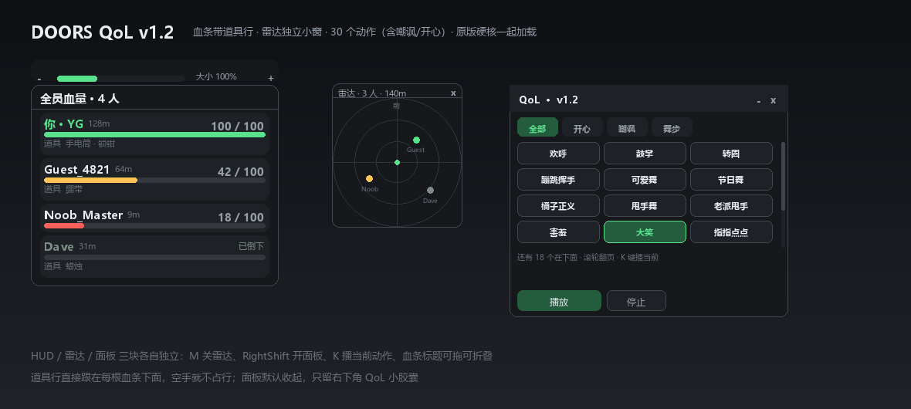

# DOORS Multiplayer QoL · v1.2

一个 loader，三块各自独立的界面：**血条（带道具行）** · **雷达小窗** · **迷你面板（30 个动作）**。
同时还负责把原版 **Doors HardCore** 拉起来。

```lua
loadstring(game:HttpGet("https://raw.githubusercontent.com/3091318935/HardCore-v0.1-HP/main/DoorsQoL-v1.2.lua?v=1.2.0"))()
```



---

## v1.2 改了什么

只动动作系统，其他一概没碰：

| | v1.1 | v1.2 |
| --- | --- | --- |
| 动作数量 | 6 个 | **30 个** |
| 分类 | 无 | **全部 / 开心 / 嘲讽 / 舞步** 四个筛选 |
| 动作 ID | 有几个是凭印象写的 | **30 个全部当场验证过**（见下） |
| 播放失败 | 只打一行控制台日志 | 按钮前面标 `✕` 并变红，一眼看出哪个在你这里加载不了 |
| 面板动作区 | 固定 96px 高 | 可滚动网格，30 个装得下 |

### 30 个动作怎么来的

从 GitHub 上两份真实的动作表挖的 ID：

- `oyy-gus/roblox-ongoing :: src/shared/Emotes/DanceConfig.luau`（185 条 name → animationId）
- `MilkFrame/MilkBox :: GameData/Wild Horse Islands [6989310863]/Emotes.lua`（经典 R15 表情表）

然后**逐个用 `assetdelivery.roblox.com` 拉回来验证**：返回 200 且资产里含 `KeyframeSequence` 的才留下。新版 UGC 表情里有一大批 ID 匿名请求会返回 401/403（比如 `griddy`、`Sturdy`），这些没敢用——宁可少几个，也不要给你一堆点了没反应的按钮。

### 动作表

**开心（10）**

| 名字 | 动画 ID | 名字 | 动画 ID |
| --- | --- | --- | --- |
| 欢呼 | 507770677 | 节日舞 | 15679621440 |
| 鼓掌 | 5915693819 | 橘子正义 | 95127716920692 |
| 转圈 | 3334968680 | 甩手舞 | 10714340543 |
| 蹦跳挥手 | 4940564896 | 老派甩手 | 5917459365 |
| 可爱舞 | 15517864808 | 害羞 | 3337978742 |

**嘲讽（8）**

| 名字 | 动画 ID | 名字 | 动画 ID |
| --- | --- | --- | --- |
| 大笑 | 507770818 | 冷笑屈膝 | 4555816777 |
| 指指点点 | 507770453 | 摆烂 | 3338010159 |
| 耸肩 | 3334392772 | 装睡 | 4686925579 |
| 摇头 | 4841401869 | 无视你 | 5230599789 |

**舞步（12）**

| 名字 | 动画 ID | 名字 | 动画 ID |
| --- | --- | --- | --- |
| 经典舞1 | 507771019 | 队列舞 | 4049037604 |
| 经典舞2 | 507776043 | 快步摇摆 | 4349242221 |
| 经典舞3 | 507777268 | 骷髅舞 | 15122972413 |
| 小碎步 | 507777826 | 机械舞 | 99649534578309 |
| 老派摇摆 | 17748314784 | 棺材出场 | 126771729094882 |
| 敬礼 | 3333474484 | 比个赞 | 4841397952 |

R6 角色只会播 R6 动画，脚本里给 `182435998` / `182436842` 两个验证过能用的做兜底。

---

## 三块界面

### 1. 血条浮层 `SG_HP_v11`（DisplayOrder 999997）

- 标题栏 `全员血量 · N 人`，拖动可挪位置，单击可折叠
- 每行：`名字 · 距离` + 右侧 `血量 / 100` + 血条（≥60% 绿 / ≥30% 琥珀 / 其余红 / 死亡灰 + 「已倒下」）
- 名字下方一行小字 `道具  手电筒 · 锁钳`：读 `Backpack` 和角色手上 `Tool`，手持的标「（手持）」，空手就不占这一行
- 标题上方尺寸条：`−` / 滑条 / `大小 100%` / `＋`，10px–26px，拖完松手才生效
- 设置页可以单独关掉「道具行」

### 2. 雷达小窗 `SG_QoL_Radar`（DisplayOrder 999996）

- 独立 ScreenGui，位置/大小/开关都独立于面板
- 以自己为中心，**屏幕上方 = 你的正前方**；三圈刻度，半径 40–400m 可调
- 队友点带名字，死亡变灰，超出半径贴边并变淡
- 标题显示 `雷达 · N 人 · XXm`，右上 `×` 关掉；`M` 键开关
- 坐标用 `CFrame:PointToObjectSpace` 换算，不手写 sin/cos

### 3. 迷你面板 `SG_QoL_Panel`（DisplayOrder 999998，默认关闭）

- 右下角 `QoL` 小胶囊打开/关闭，`RightShift` 也行
- 两页：
  - **动作**：30 个动作，四个分类筛选，点一下播、再点停；`K` 播当前动作；加载不了的会标 `✕`
  - **设置**：血条开关 / 道具行开关 / 字号 / 雷达开关 / 雷达尺寸 / 雷达半径 / 三个快捷键 / 原版脚本状态 + 「重新加载」/ 重置
- 右下角斜纹可拖大小，标题栏可拖动

---

## 默认按键

| 键 | 作用 |
| --- | --- |
| `RightShift` | 开/关迷你面板 |
| `M` | 开/关雷达小窗 |
| `K` | 播放 / 停止当前动作 |

三个都能在设置页点一下重新绑，按 `Escape` 取消。

---

## 原版硬核脚本

启动后按顺序尝试：

1. `https://pastefy.app/Bf6hbDY4/raw`
2. `https://raw.githubusercontent.com/Zero0Star/RipperNewSound/master/HardCoreLua.lua`
3. `https://raw.githubusercontent.com/Zero0Star/RipperNewSound/master/HardCore-Mode.lua`

> v0.1 里写的 fallback 是 `Doors-HardCore.lua`，**那个文件在仓库里根本不存在**，所以下载失败后静默结束——这就是「注入后没弹硬核弹窗」的原因。现在换成了仓库里真实存在的 `HardCoreLua.lua`（393 KB 那版，启动提示 `Doors HardCore V10.6.3`）。

设置页最下面那行状态：

- `已加载: pastefy.app` / `已加载: raw.githubusercontent.com` → 成功
- `全部源失败（下载失败/编译失败/运行报错）` → 点「重新加载」，F9 有每条源的具体错误

---

## 配置文件

`QoL_v11.json`（沿用 v1.1 的文件名，所以旧设置不会丢）：

```json
{
  "hudOn": true, "showItems": true,
  "hudX": 16, "hudY": 96, "fs": 15, "collapsed": false,
  "radarOn": true, "radarSize": 168, "radarRange": 140,
  "radarX": 16, "radarY": 300,
  "panelX": 60, "panelY": 120,
  "anim": 1,
  "kPanel": "RightShift", "kRadar": "M", "kDance": "K"
}
```

`anim` 是 1–30 的动作序号。删掉这个文件就恢复默认。

---

## API

```lua
local q = getgenv().QoL
q.hud.setSize(18)          -- 血条字号 10..26
q.hud.setVisible(false)    -- 等同设置里的血条开关
q.radar.setVisible(true)
q.radar.applySize(220)     -- 120..320
q.panel.setOpen(true)
q.dance.play(24)           -- 1..30
q.dance.stop()
q.dance.list               -- 30 条 {name, cat, id}
q.panel.setDanceCat("taunt")  -- all / happy / taunt / dance
q.original()               -- 手动重新加载原版脚本
q.save()                   -- 立即落盘
```

---

## 文件

| 文件 | 说明 |
| --- | --- |
| `DoorsQoL-v1.2.lua` | 主脚本，单文件 |
| `loader.lua` | 一行 loader |
| `preview-v1.2.png` | 布局示意图 |
| `preview12.py` | 重画示意图的脚本 |
| `push.ps1` | 推送脚本（纯 ASCII，避免 PS 5.1 编码坑） |
| `DoorsQoL-v1.1.lua` | 上一版：6 个动作，保留可回滚 |
| `preview-v1.1.png` | v1.1 示意图 |

回滚：

```lua
loadstring(game:HttpGet("https://raw.githubusercontent.com/3091318935/HardCore-v0.1-HP/main/DoorsQoL-v1.1.lua"))()
loadstring(game:HttpGet("https://raw.githubusercontent.com/3091318935/HardCore-v0.1-HP/main/HardCore-v0.1-HP.lua"))()
```

---

## 边界（不吹）

- 动作走本地 `Animator`，**只有自己看得到**；多人同步要服务器侧播放，没做，也不碰反作弊
- 30 个 ID 都是「资产能取到」级别的验证，**不等于在你的执行器 + 当前游戏里一定能播**——真播不出来会标 `✕`，把那个名字发我，换下一个
- 雷达朝向取自己角色的 `LookVector`，快速转身会有点滞后；超出半径贴边显示，不代表真实距离
- 道具只能读到名字，没有图标 ID 就不画图标；队友道具只有在其 Tool 复制到客户端时才看得到
- 原版脚本是第三方代码，被 `pcall` 包着跑，它报错不会连累 QoL

---

## 变更记录

- **v1.2**：动作 6 → 30 个，分「开心 / 嘲讽 / 舞步」三类 + 筛选芯片；30 个动画 ID 全部当场验证；播放失败标 `✕` 变红；动作区改成可滚动网格；`Dance.list` / `Panel.setDanceCat` 进 API。
- **v1.1**：删掉事件日志、玩家信息页、道具页；道具并进血条每行下方；雷达改成独立小窗；面板缩到 360×300 且默认收起；修好原版脚本 fallback 不存在导致「没弹硬核弹窗」。
- **v1.0**：单面板 + 六分类 + 事件日志 + 动作系统 + 统一设置。
- **v0.1.2**：血条浮层 + 尺寸调节条。
