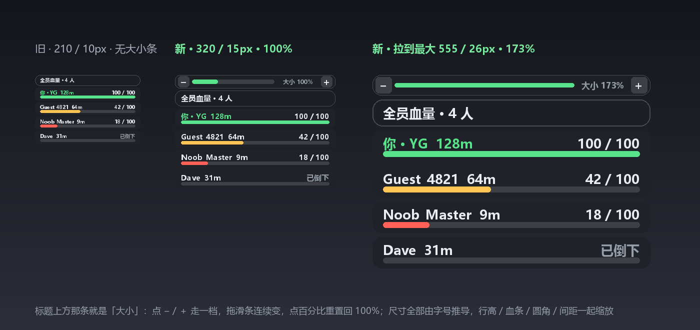

# 硬核 v0.1 · 单功能（全员血量）

源脚本只有一行，照旧跑：

```lua
loadstring(game:HttpGet("https://pastefy.app/Bf6hbDY4/raw"))()
```

这个版本在它外面**只加一样东西**：右上角一块「全员血量」浮层。换肤、壁纸、光影、音乐、翻译、面板——统统没有，原脚本的界面和逻辑一行都没动。

```lua
loadstring(game:HttpGet("https://raw.githubusercontent.com/3091318935/HardCore-v0.1-HP/main/HardCore-v0.1-HP.lua"))()
```

---

## 它长什么样

```
┌────────────────────────────────────────────┐
│ 全员血量 · 4 人                             │  ← 拖这里挪位置，点一下折叠
├────────────────────────────────────────────┤
│ 你 · YG                              128m  │
│ 100 / 100                                  │
│ ██████████████████████████████████████     │
├────────────────────────────────────────────┤
│ Guest_4821                            64m  │
│ 42 / 100                                   │
│ ██████████████░░░░░░░░░░░░░░░░░░░░░░░      │
└────────────────────────────────────────────┘
```

- 名字（自己带 `你 · `，可选距离）+ `当前 / 上限` 数字 + 6px 血条；面板宽 320、字号 15、每行 36px（v0.1 原版是 210 / 10 / 22，整整大一圈）
- 血条按比例上色：>60% 绿、30~60% 橙、<30% 红；`Health <= 0` 显示「已倒下」并置灰
- 0.25 秒轮询，**只读** `Humanoid.Health / MaxHealth`，不写任何游戏状态，不发请求，不碰原脚本
- 玩家进出、重生、换图自动跟上；`ResetOnSpawn = false`
- 位置和折叠状态存 `SG_HP_v01.json`，下次注入照旧
- 独立 `ScreenGui`（`SG_HP_v01`，`DisplayOrder 999997`），跟原脚本 UI 不抢层级



> 上图由 `hud-preview.py` 按脚本里同一套尺寸公式重画（不是截图）。想再大再小：改 `CONFIG.fontSize`（10~22）或 `CONFIG.scale`（0.8~1.4）。

## 手势

| 动作 | 效果 |
| --- | --- |
| 拖标题栏 | 挪位置，松手落盘 |
| 单击标题栏（没拖动） | 折叠 / 展开列表 |

## CONFIG

文件顶部就这几项，改完保存即可：

```lua
local CONFIG = {
    scriptUrl   = "https://pastefy.app/Bf6hbDY4/raw",
    fallbackUrl = "https://raw.githubusercontent.com/Zero0Star/RipperNewSound/master/Doors-HardCore.lua",
    runOriginal = true,   -- 载入并运行源脚本
    waitTimeout = 30,

    refresh   = 0.25,     -- 刷新间隔（秒）
    showDist  = true,     -- 名字后面带距离
    aliveOnly = false,    -- true = 只列活人
    sortByHp  = false,    -- true = 按血量降序

    width     = 320,      -- 面板宽度
    fontSize  = 15,       -- 主体字号；行高 / 血条 / 标题栏全部按它推
    topX      = 16,       -- 距右边缘
    topY      = 96,       -- 距顶部
    scale     = 1,        -- 整体再缩放 0.8 ~ 1.4
    cfgFile   = "SG_HP_v01.json",
}
```

## 和 v8 的关系

| | 硬核 v0.1（这个仓库） | 无痕玻璃 v8（[别的仓库](https://github.com/3091318935/Roblox)） |
| --- | --- | --- |
| 换肤 / 玻璃边框 | — | ✅ |
| 壁纸 / 动态壁纸 / 雾化 | — | ✅ |
| 光影清单 / 光影包 | — | ✅ 25 套 |
| 音乐 / 翻译 / 面板 | — | ✅ |
| **全员血量 HUD** | ✅ 唯一功能 | ✅ |

代码是从 v8 里摘出来的单品，没有共享文件，互不影响；两个一起注入也能活着（会画两块血量，开一个就行）。

## 文件

| 文件 | 作用 |
| --- | --- |
| `HardCore-v0.1-HP.lua` | 全部逻辑（501 行，单文件） |
| `loader.lua` | 一行 loader |
| `README.md` | 本文件 |

## 更新

改完直接覆盖仓库里的 `HardCore-v0.1-HP.lua` 即可（网页上传也行）。执行器有缓存的话，重新 `HttpGet` 一次就是新版，控制台会打印 `[硬核v0.1] 单功能版已启动`。

本地一键同步（token 缓存在 `%LOCALAPPDATA%\DSH-Sync\token.txt`，没变过的文件自动跳过）：

```powershell
powershell -ExecutionPolicy Bypass -File .\single\push.ps1
```

---

## 变更记录

- **v0.1.1 · 放大**：宽 210 → **320**、字号 10 → **15**、行高 22 → **36**、血条 3px → **6px**、标题栏 22 → **31**、圆角与内边距同步放大；新增 `CONFIG.fontSize`（10~22），行高 / 血条 / 标题栏 / 间距全部由它推导，改一个数字整块等比变；名字与血量数字改用 GothamSemibold。
- **v0.1**：首版，只加全员血量浮层，其余一行不动。
